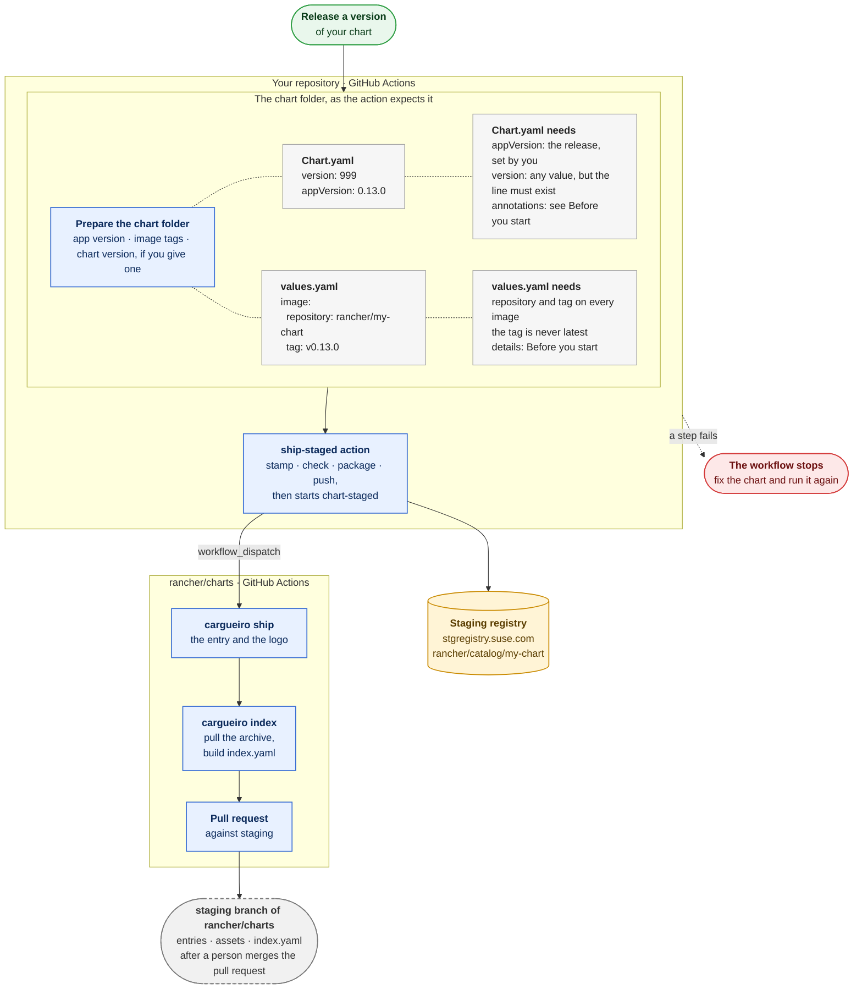

# Releasing a chart with cargueiro

For chart owners. This is how a chart gets from your repository to the staging registry, and from there to the `staging` branch of `rancher/charts`. Your repository calls one composite action from its GitHub Actions workflow. The action runs the cargueiro commands in your job, and a step that fails stops the workflow and says why on its log. This guide says what to ask for, what to write, and what happens next.

Which composite action you call depends on what you release:

| You release | You call | You get |
|-------------|----------|---------|
| One chart | `ship-staged` | One pull request with that chart. |
| The charts of a family, such as `fleet`, `fleet-agent` and `fleet-crd`, together | `ship-family-staged` | One pull request with all of them. |

A family is the set of charts that `rules.yaml` lists under one `family:` name. Its charts are released as one unit and have the same version.

In both cases you give the final version of the chart, or leave it out and cargueiro works it out from the `appVersion` and the versions already released.

Actions are here: https://github.com/rancher/charts/tree/staging/.github/actions

## Before you start: what the provided GHAs require

The actions only run the commands. What they need from you comes first: the access they read from Vault, the chart folders they are given, and the rules those folders have to follow.

### What you need, and from whom

A repository that releases a chart needs things from three places: cargueiro, `rancher/charts` and EIO. The action reads the credentials from Vault, under the path of your repository.

#### From cargueiro

| What | What it is for | What you do |
|------|----------------|-------------|
| The chart in [`rules.yaml`](https://github.com/rancher/cargueiro/blob/main/rules.yaml) | It says what each chart must be: its kind, its family and the annotations it needs. A chart that is not listed is refused by every command. | Add it yourself with a pull request to `rancher/cargueiro`, and ask the release team to review it. |

#### From rancher/charts

| What | What it is for | What you do |
|------|----------------|-------------|
| The `ship-staged` or `ship-family-staged` action | The steps your workflow calls: it checks and pushes the chart, and starts the `chart-staged` workflow. | Add a job to your workflow that calls it from the [`chart-owners`](https://github.com/rancher/charts/tree/chart-owners) branch of `rancher/charts`, with `uses: rancher/charts/.github/actions/ship-staged@chart-owners` or `....ship-family-staged@chart-owners`, after the checkout and the preparation of the chart folder. The repository is public, so there is nothing to request, and the organization allows any `rancher/*` action with any ref. The branch holds only the actions and the templates, so it moves only when they change. A repository that pins its actions to a commit SHA, as `webhook-security` does, uses the SHA of a commit of that branch instead of `chart-owners`, and updates it when the branch changes. Example: [`stage-chart.yaml`](https://github.com/rancher/webhook/blob/main/.github/workflows/stage-chart.yaml) and [`prepare-chart.sh`](https://github.com/rancher/webhook/blob/main/.github/workflows/scripts/prepare-chart.sh) in `rancher/webhook`. The same branch has generic templates for the chart preparation: [`templates`](https://github.com/rancher/charts/tree/chart-owners/.github/templates). |
| The [`chart-staged`](https://github.com/rancher/charts/tree/staging/.github/workflows/chart-staged.yaml) workflow | It ships and indexes the chart when it is dispatched, and opens the pull request against `staging`. | Nothing to write: the action starts it with a `workflow_dispatch` on `chart-staged.yaml`, with the chart, or the family, and the version that was pushed as its inputs. You run your workflow when you release, as `rancher/webhook` does in the step [`Trigger Stage chart workflow`](https://github.com/rancher/webhook/blob/main/.github/workflows/cut-release.yaml#L120). chart families can also use it.|
| An approval of the pull request | The `staging` branch takes no direct pushes. | Review/Approve/Merge. Example: [rancher/charts#9390](https://github.com/rancher/charts/pull/9390), the pull request for `rancher-webhook` `112.0.0+up0.13.0-rc.4`. |

#### From EIO

| What | What it is for | What you ask for |
|------|----------------|------------------|
| A Vault role for the repository | The job logs in with its OIDC token, and the role is named after the repository. A repository that already reads secrets from Vault has it. | The role, if the repository has none. |
| The staging registry credentials | The push to the staging registry. | `rancher-prime-stg-registry/credentials` at `github/repo/rancher/<repository>/`, with `username`, `password` and `registry` (`stgregistry.suse.com`), able to push to `stgregistry.suse.com/rancher/catalog`. |
| The `chart-staged` token | A short-lived token from Vault, scoped to `rancher/charts` with only `actions: write`, which the action uses to start the `chart-staged` workflow. There is no GitHub App to create, and no `appId` or `privateKey` to store. | Access to the `chart-staged` token for `rancher/<repository>`. The action reads the token from Vault. |

To ask, open an issue in [`rancherlabs/eio`](https://github.com/rancherlabs/eio) with the repository and what it needs. EIO decides whether to create something new, reuse what exists, or expand its permissions. This should be enough:

```
Repository: rancher/<repository>

1. A Vault role for the repository, if it has none.
2. rancher-prime-stg-registry/credentials under github/repo/rancher/<repository>/ with username,
   password and registry, able to push to stgregistry.suse.com/rancher/catalog.
3. Access to the chart-staged token for rancher/<repository>.
```

### The chart folder

The action takes a folder with the chart and, if you give one, the final version of the chart; without it, the version is worked out. Everything that only your repository knows is set before the action.
- Copy the chart to a temporary folder first, so the checkout stays as it is.
- In the copy, set the `appVersion` and the image tags in `values.yaml` to the release; `stamp` changes neither.
- If `Chart.yaml` already has a `helm.sh/images` annotation, its image tags are the release too, because `stamp` keeps an annotation that exists and refuses an image tagged `latest`.
- `Chart.yaml` must have a `version:` line, with any placeholder value, because the action stamps the final version. The final version is `1XY.Z.W+upA.B.C`.
  - Give it as the `version` input. How you work it out is yours: `rancher/webhook` reads the `1XY` from a table in its `VERSION.md`.
  - Or leave the `version` input out, and the action works it out with [`cargueiro chart-version`](../cmd/docs/chart-version.md) from the `appVersion` of the copy, which must be set first, and the versions already released in the staging registry.

For a family, prepare a folder for each of its charts in the same way. They all take one version, the one of the main chart, which is the chart that `rules.yaml` marks `kind: main`. If you leave `version` out, the action works it out from the `appVersion` of the main chart only, and it stops when the other charts are not at the same latest released version as the main chart. Then every chart is checked against that version, so a chart that is for another Rancher version than the major of the version is refused.

`rancher/webhook` is the example. Its script `prepare-chart.sh` copies `charts/rancher-webhook` to a temporary folder, changes three lines, and prints the version. It reads the chart major from a table, which leaving the `version` input out replaces. For the tag `v0.13.0-rc.7`, this is what differs from the source:

```diff
 Chart.yaml
-appVersion: "999"
+appVersion: 0.13.0-rc.7
   helm.sh/images: |
     - name: rancher-webhook
-      image: rancher/rancher-webhook:latest
+      image: rancher/rancher-webhook:v0.13.0-rc.7

 values.yaml
 image:
   repository: rancher/rancher-webhook
-  tag: latest
+  tag: v0.13.0-rc.7
```

The folder then has the files of a Helm chart, `Chart.yaml`, `values.yaml`, `templates/` and `tests/`, and this is its `Chart.yaml` when the action starts:

```yaml
apiVersion: v2
name: rancher-webhook
description: ValidatingAdmissionWebhook for Rancher types
version: "999"
appVersion: 0.13.0-rc.7
annotations:
  catalog.cattle.io/certified: rancher
  catalog.cattle.io/hidden: "true"
  catalog.cattle.io/namespace: cattle-system
  catalog.cattle.io/release-name: rancher-webhook
  catalog.cattle.io/os: linux
  catalog.cattle.io/permits-os: linux,windows
  catalog.cattle.io/rancher-version: ">= 2.17.0-0 < 2.18.0-0"
  catalog.cattle.io/kube-version: ">= 1.35.0-0 < 1.38.0-0"
  catalog.cattle.io/managed: "true"
  helm.sh/images: |
    - name: rancher-webhook
      image: rancher/rancher-webhook:v0.13.0-rc.7
```

The action stamps it with the version `112.0.0+up0.13.0-rc.7`, which is the `version` input.

### The rules of the chart

`check chart` applies the rules of `rules.yaml` to `Chart.yaml` and `values.yaml`, and `package` runs it before it builds the archive. The rules are written in [Chart annotation rules](DEVELOPING.md#chart-annotation-rules), for the version and the annotations of each kind of chart, and in [helm.sh/images](DEVELOPING.md#helmshimages), for the images in `values.yaml` and the annotation that lists them. One rule is not checked by `check chart` but when the chart is shipped in `rancher/charts`: a main chart needs an `icon` that is an `http` or `https` address of a logo, unless `rules.yaml` marks it `icon: skip`.

## The whole path



## Call the action

```yaml
jobs:
  stage-chart:
    runs-on: ubuntu-latest
    permissions:
      contents: read
      id-token: write # to log in to Vault
    steps:
      - uses: actions/checkout@<version>
      - name: Prepare the chart
        id: prepare
        run: |
          version=$(./prepare-chart.sh "$RELEASE_TAG" "$RUNNER_TEMP/chart")
          echo "version=$version" >> "$GITHUB_OUTPUT"
      - uses: rancher/charts/.github/actions/ship-staged@chart-owners
        with:
          chart-dir: ${{ runner.temp }}/chart/my-chart
          version: ${{ steps.prepare.outputs.version }}
```

To have the version worked out, call the action without `version`. The `appVersion` of the folder must be set:

```yaml
      - uses: rancher/charts/.github/actions/ship-staged@chart-owners
        with:
          chart-dir: ${{ runner.temp }}/chart/my-chart
```

For the charts of a family, call `ship-family-staged` with the name of the family and the folder of each chart, one to a line, in any order. `version` is optional here too:

```yaml
      - uses: rancher/charts/.github/actions/ship-family-staged@chart-owners
        with:
          family: fleet
          chart-dirs: |
            ${{ runner.temp }}/charts/fleet
            ${{ runner.temp }}/charts/fleet-agent
            ${{ runner.temp }}/charts/fleet-crd
```

Its outputs are `family`, `references`, one reference for each chart in the order of the family, and `version`.

The action checks the job and the credentials first, then reads the token for `rancher/charts` from Vault, installs the latest cargueiro, works out the version when you give none, and stamps, checks, packages and pushes the chart. Only then does it start the `chart-staged` workflow, with the name and the version. All that can fail on credentials fails before the push, because a version that is pushed stays in the registry. It has the outputs `chart`, `reference` and `version`, the one it used.

## What rancher/charts does

The dispatch starts the `chart-staged` workflow in `rancher/charts`, which runs `cargueiro ship` and `cargueiro index` for that version, and opens a pull request against `staging` with the entry, the logo, the archive and `index.yaml`. The `staging` branch takes no direct pushes: a person with write access to `rancher/charts` approves and merges the pull request. Every pull request changes `index.yaml`, so when several charts are sent together, merge them one at a time. A version that was shipped already fails there, on purpose.

## When something fails

The log of the action starts with the repository, the ref, the folder and the version, then says for each credential only whether it was loaded, never its value, and it names the command that failed. A failure before the push leaves nothing behind: fix it and run the workflow again. This includes a version that cannot be worked out, such as a chart with no `appVersion` or a registry that cannot be read. A version is pushed once, so after the push the same version can't be run again. If only the dispatch failed, start the `chart-staged` workflow of `rancher/charts` by hand with the same values, which needs write access to that repository: with the command below, or with Run workflow in its Actions tab.

```
gh workflow run chart-staged.yaml --repo rancher/charts --ref staging \
  -f chart=my-chart \
  -f version=112.0.0+up0.13.0
```

For a family, give `-f family=<family>` instead of `chart`.

## The commands behind the action

These are the commands the action runs, in the order it runs them, for when you need to run one by hand. Each one has its page in [`cmd/docs`](../cmd/docs), with the flags and the exit codes.

| Order | Command | What it does to the chart | Docs |
|-------|---------|---------------------------|------|
| 1 | `curl -fsSL https://github.com/rancher/cargueiro/releases/latest/download/install.sh \| sh -` | Installs cargueiro, after checking the download against the checksums of the release. `CARGUEIRO_VERSION` names a release to pin. | |
| 2 | `cargueiro chart-version <folder>` | Only when you give no version: prints the final version, worked out from the `appVersion` and the versions already released in the staging registry. Writes nothing. | [chart-version](../cmd/docs/chart-version.md) |
| 3 | `cargueiro stamp <folder> --version <version>` | Puts the final version on `Chart.yaml` and lists the images of `values.yaml` in `helm.sh/images`. Refuses a version or an image tag that breaks the rules. | [stamp](../cmd/docs/stamp.md) |
| 4 | `cargueiro check chart <folder>` | Checks the annotations of the kind of the chart, `helm.sh/images` and the version against the rules. Exits with 1 and prints every error when the chart is not valid. | [check chart](../cmd/docs/check-chart.md) |
| 5 | `cargueiro package <folder> --output-dir <dir>` | Runs the same check, builds the archive and prints its path. The archive is removed and the step fails if it is not valid or if a file differs from the folder. | [package](../cmd/docs/package.md) |
| 6 | `cargueiro push <archive> --registry <registry>/rancher/catalog` | Pushes the archive to the staging registry, with the credentials from `CARGUEIRO_USERNAME` and `CARGUEIRO_PASSWORD`. A version is pushed once, and a chart goes only to the repository of its edition. Prints the reference it pushed. | [push](../cmd/docs/push.md) |
| 7 | `gh workflow run chart-staged.yaml --repo rancher/charts --ref staging ...` | Starts the `chart-staged` workflow of `rancher/charts` with the name and the version of the chart, which ships and indexes it (see [What rancher/charts does](#what-ranchercharts-does)). | |

For a family, the action runs the same commands with `--family <name>` and the folders of every chart, or their archives for `push`: `chart-version --family`, `stamp --family`, `check chart --family`, `package --family` and `push --family`. Each one refuses folders or archives that are not exactly the charts of the family before it changes anything, and the main chart comes first.
