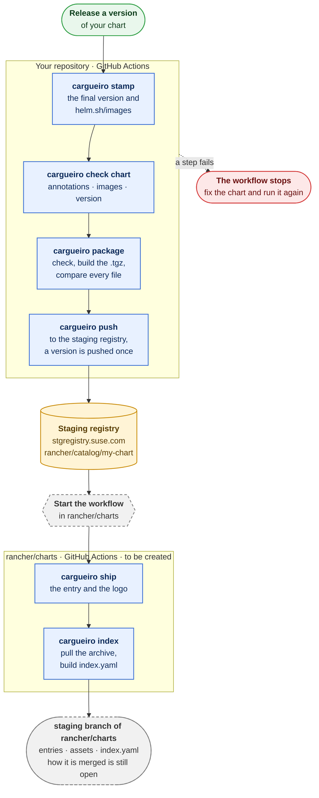

# Releasing a chart with cargueiro

For chart owners. This is how a chart gets from your repository to the staging registry, and from there to the `staging` branch of `rancher/charts`. The steps run in the GitHub Actions workflow of your repository. Each one is a cargueiro command that exits with 1 and says why on stderr when something is wrong, so a step that fails stops the workflow and nothing after it runs.

How cargueiro gets installed in the workflow is not covered here yet.

## The whole path



## Before you start

- The chart is listed in `rules.yaml`, which is compiled into cargueiro. It says what each chart must be: its kind, its family and the annotations it needs. A chart that is not listed is refused by every command; ask the release team to add it.
- The images in `values.yaml` have a `repository` and a `tag`, and the tag is the one you are releasing. A tag of `latest`, or none, is refused. Set `appVersion` and the image tags to the release first, as `stamp` changes neither.
- `Chart.yaml` has the `catalog.cattle.io/rancher-version` annotation. The Rancher version in it decides the major of the chart version.

## 1. Stamp the chart

```
cargueiro stamp charts/my-chart --version 112.0.0+up0.13.0
```

It puts the final version on the chart and lists its images in `helm.sh/images`. Only the `version` line and that annotation of `Chart.yaml` change, so the diff in your workflow shows nothing else. It refuses a version that does not follow the rules, and an image whose tag is `latest`.

`--version` is yours: it is the version of your release, and `stamp` does not compare it with anything but the rules. Give it. Without it, `stamp` works the version out from the versions already in the staging registry, which reads the registry: give `--username` and the password the way `push` takes them if it asks for credentials. `--dry-run` prints what would change and writes nothing. Charts for Rancher 2.15 and before are not supported.

## 2. Check the chart

```
cargueiro check chart charts/my-chart
```

It reads `Chart.yaml` and `values.yaml`, and nothing else in the folder, and checks them against the rules of the chart. The report has three sections:

- `annotations`: the annotations the chart needs for its kind, and their form.
- `hip15-annotations`: `helm.sh/images` lists every image in `values.yaml` ([HIP-0015](https://helm.sh/community/hips/hip-0015/)).
- `version`: the version is `1XY.Z.W+upA.B.C`, and `1XY` matches the Rancher version of the chart (`111` for 2.16, `112` for 2.17).

It goes after `stamp` because a chart that is not stamped yet fails in `version` and in `hip15-annotations`, which is what `stamp` puts right. The `annotations` section is the one `stamp` cannot fix, and where you will usually see an error. `--output json` prints the report as JSON.

## 3. Package the chart

```
cargueiro package charts/my-chart --output-dir dist
```

It makes the archive (`.tgz`) and prints its path, and nothing else, on stdout. It does not change the chart: stamp it first. Before packaging, it runs the same check as `check chart` on the folder, so a chart that is not valid is not packaged, and after packaging it checks the archive. It then compares every file of the folder with the same file in the archive. If the archive is not valid, or differs from the folder, it is removed and the step fails.

## 4. Push the chart

```
cargueiro push dist/my-chart-112.0.0+up0.13.0.tgz --registry stgregistry.suse.com/rancher/catalog
```

The registry is the staging registry of the chart's edition. The username and the password come from `CARGUEIRO_USERNAME` and `CARGUEIRO_PASSWORD`, which your workflow reads from its secrets. It prints the reference it pushed. On SUSE registries it enforces two rules, and refuses with the reason otherwise:

- A chart goes only to the repository of its edition, never to the one for images.
- It never replaces a version that is there: a tag is pushed once. Running the step again for the same version fails, on purpose.

## 5. Ship it to rancher/charts

After the push, the chart is in the staging registry, but not in `rancher/charts`. Your workflow starts a workflow in that repository, which runs `cargueiro ship` for the chart you pushed and then `cargueiro index`. `ship` writes the entry of the version and its logo, and `index` pulls the archive and builds the index. This workflow does not exist yet; this part of the page will say how to call it when it does.

## All together

```
cargueiro stamp charts/my-chart --version "$CHART_VERSION"
cargueiro check chart charts/my-chart
archive=$(cargueiro package charts/my-chart --output-dir dist)
cargueiro push "$archive" --registry stgregistry.suse.com/rancher/catalog
```
