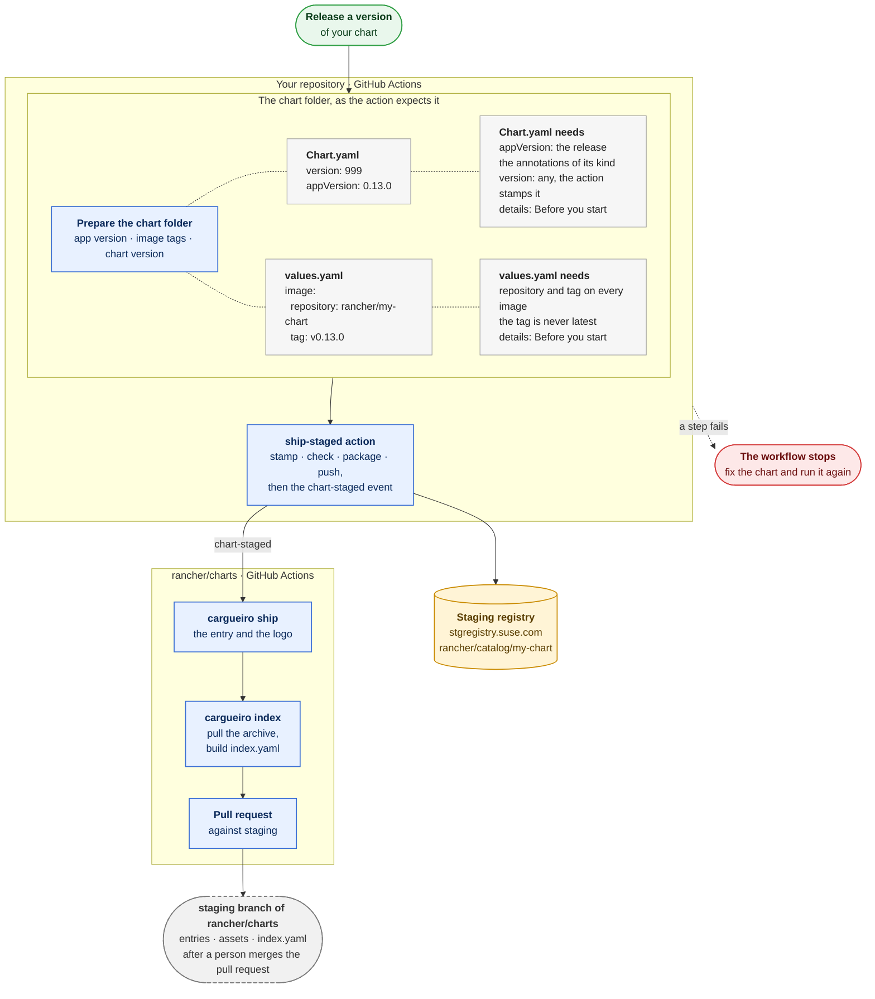

# Releasing a chart with cargueiro

For chart owners. This is how a chart gets from your repository to the staging registry, and from there to the `staging` branch of `rancher/charts`. Your repository calls one action, `ship-staged`, from its GitHub Actions workflow. The action runs the cargueiro commands in your job, and a step that fails stops the workflow and says why on its log. This guide says what to ask for, what to write, and what happens next.

## Before you start: what the provided GHAs require

The `ship-staged` action only runs the commands. What it needs from you comes first: the access it reads from Vault, the chart folder it is given, and the rules that folder has to follow.

### What to ask for

The action reads everything it needs from Vault, under the path of your repository, so a repository that releases a chart needs four things. The first is for the release team, and the other three are an EIO request.

- **The chart in [`rules.yaml`](https://github.com/rancher/cargueiro/blob/main/rules.yaml)**, which is compiled into cargueiro. It says what each chart must be: its kind, its family and the annotations it needs. A chart that is not listed is refused by every command.
- **A Vault role for the repository.** The job logs in with its OIDC token, and the role is named after the repository. A repository that already reads secrets from Vault has it.
- **The staging registry credentials** at `github/repo/rancher/<repository>/rancher-prime-stg-registry/credentials`, with the fields `username`, `password` and `registry` (`stgregistry.suse.com`). The account has to be able to push to `stgregistry.suse.com/rancher/catalog`.
- **A GitHub App installed on `rancher/charts`** with the repository permission Contents: write, and its credentials at `github/repo/rancher/<repository>/github/app-credentials`, with the fields `appId` and `privateKey`. The action uses it to send the event to `rancher/charts`. `rancher/webhook` has one.

For the EIO request, this is enough:

```
Repository: rancher/<repository>

1. A Vault role for the repository, if it has none.
2. rancher-prime-stg-registry/credentials under github/repo/rancher/<repository>/ with username,
   password and registry, able to push to stgregistry.suse.com/rancher/catalog.
3. A GitHub App installed on rancher/charts with Contents: write, and its appId and privateKey
   at github/repo/rancher/<repository>/github/app-credentials.
```

### The chart folder

The action takes a folder with the chart and the final version of the chart, and everything that only your repository knows is set before it. Copy the chart to a temporary folder first, so the checkout stays as it is. In the copy, set the `appVersion` and the image tags in `values.yaml` to the release; `stamp` changes neither. If `Chart.yaml` already has a `helm.sh/images` annotation, its image tags are the release too, because `stamp` keeps an annotation that exists and refuses an image tagged `latest`. The `version` in `Chart.yaml` can be any placeholder, because the action stamps the final one, which you give as an input. How you work out that version is yours: it is `1XY.Z.W+upA.B.C`, and `rancher/webhook` reads the `1XY` from a table in its `VERSION.md`.

`rancher/webhook` is the example. Its script `prepare-chart.sh` copies `charts/rancher-webhook` to a temporary folder, changes three lines, and prints the version. For the tag `v0.13.0-rc.7`, this is what differs from the source:

```diff
 Chart.yaml
-appVersion: "999"
+appVersion: 0.13.0-rc.7
   helm.sh/images: |
     - name: rancher-webhook
-      image: rancher/rancher-webhook:latest
+      image: rancher/rancher-webhook:v0.13.0-rc.7

 values.yaml
 image:
   repository: rancher/rancher-webhook
-  tag: latest
+  tag: v0.13.0-rc.7
```

The folder then has the files of a Helm chart, `Chart.yaml`, `values.yaml`, `templates/` and `tests/`, and this is its `Chart.yaml` when the action starts:

```yaml
apiVersion: v2
name: rancher-webhook
description: ValidatingAdmissionWebhook for Rancher types
version: "999"
appVersion: 0.13.0-rc.7
annotations:
  catalog.cattle.io/certified: rancher
  catalog.cattle.io/hidden: "true"
  catalog.cattle.io/namespace: cattle-system
  catalog.cattle.io/release-name: rancher-webhook
  catalog.cattle.io/os: linux
  catalog.cattle.io/permits-os: linux,windows
  catalog.cattle.io/rancher-version: ">= 2.17.0-0 < 2.18.0-0"
  catalog.cattle.io/kube-version: ">= 1.35.0-0 < 1.38.0-0"
  catalog.cattle.io/managed: "true"
  helm.sh/images: |
    - name: rancher-webhook
      image: rancher/rancher-webhook:v0.13.0-rc.7
```

The action stamps it with the version `112.0.0+up0.13.0-rc.7`, which is the `version` input.

### The rules of the chart

`check chart` applies the rules of `rules.yaml` to `Chart.yaml` and `values.yaml`, and `package` runs it before it builds the archive. The rules are written in [Chart annotation rules](DEVELOPING.md#chart-annotation-rules), for the version and the annotations of each kind of chart, and in [helm.sh/images](DEVELOPING.md#helmshimages), for the images in `values.yaml` and the annotation that lists them. One rule is not checked by `check chart` but when the chart is shipped in `rancher/charts`: a main chart needs an `icon` that is an `http` or `https` address of a logo, unless `rules.yaml` marks it `icon: skip`.

## The whole path



## Call the action

```yaml
jobs:
  stage-chart:
    runs-on: ubuntu-latest
    permissions:
      contents: read
      id-token: write # to log in to Vault
    steps:
      - uses: actions/checkout@<version>
      - name: Prepare the chart
        id: prepare
        run: |
          version=$(./prepare-chart.sh "$RELEASE_TAG" "$RUNNER_TEMP/chart")
          echo "version=$version" >> "$GITHUB_OUTPUT"
      - uses: rancher/charts/.github/actions/ship-staged@staging
        with:
          chart-dir: ${{ runner.temp }}/chart/my-chart
          version: ${{ steps.prepare.outputs.version }}
```

The action checks the job and the credentials first, then makes the token for `rancher/charts`, installs the latest cargueiro, and stamps, checks, packages and pushes the chart. Only then does it send the `chart-staged` event, with the name and the version. All that can fail on credentials fails before the push, because a version that is pushed stays in the registry. It has the outputs `chart` and `reference`.

## What rancher/charts does

The event starts a workflow in `rancher/charts` that runs `cargueiro ship` and `cargueiro index` for that version, and opens a pull request against `staging` with the entry, the logo, the archive and `index.yaml`. The `staging` branch takes no direct pushes: a person with write access to `rancher/charts` approves and merges the pull request. Every pull request changes `index.yaml`, so when several charts are sent together, merge them one at a time. A version that was shipped already fails there, on purpose.

## When something fails

The log of the action starts with the repository, the ref, the folder and the version, then says for each credential only whether it was loaded, never its value, and it names the command that failed. A failure before the push leaves nothing behind: fix it and run the workflow again. A version is pushed once, so after the push the same version can't be run again. If only the event failed, send it again by hand, or start the chart-staged workflow of `rancher/charts` with the same two values.

```
gh api "repos/rancher/charts/dispatches" \
  -f event_type=chart-staged \
  -f "client_payload[chart]=my-chart" \
  -f "client_payload[version]=112.0.0+up0.13.0"
```

## The commands behind the action

These are the commands the action runs, for when you need to run one by hand. Install cargueiro with `curl -fsSL https://github.com/rancher/cargueiro/releases/latest/download/install.sh | sh -`. It checks the download against the checksums of the release, and `CARGUEIRO_VERSION` names a release to pin.

### Stamp the chart

```
cargueiro stamp charts/my-chart --version 112.0.0+up0.13.0
```

It puts the final version on the chart and lists its images in `helm.sh/images`. Only the `version` line and that annotation of `Chart.yaml` change, so the diff in your workflow shows nothing else. It refuses a version that does not follow the rules, and an image whose tag is `latest`.

`--version` is yours: it is the version of your release, and `stamp` does not compare it with anything but the rules. Give it. Without it, `stamp` works the version out from the versions already in the staging registry, which reads the registry: give `--username` and the password the way `push` takes them if it asks for credentials. `--dry-run` prints what would change and writes nothing. Charts for Rancher 2.15 and before are not supported.

### Check the chart

```
cargueiro check chart charts/my-chart
```

It reads `Chart.yaml` and `values.yaml`, and nothing else in the folder, and checks them against the rules of the chart. The report has three sections:

- `annotations`: the annotations the chart needs for its kind, and their form.
- `hip15-annotations`: `helm.sh/images` lists every image in `values.yaml` ([HIP-0015](https://helm.sh/community/hips/hip-0015/)).
- `version`: the version is `1XY.Z.W+upA.B.C`, and `1XY` matches the Rancher version of the chart (`111` for 2.16, `112` for 2.17).

It goes after `stamp` because a chart that is not stamped yet fails in `version` and in `hip15-annotations`, which is what `stamp` puts right. The `annotations` section is the one `stamp` cannot fix, and where you will usually see an error. `--output json` prints the report as JSON.

### Package the chart

```
cargueiro package charts/my-chart --output-dir dist
```

It makes the archive (`.tgz`) and prints its path, and nothing else, on stdout. It does not change the chart: stamp it first. Before packaging, it runs the same check as `check chart` on the folder, so a chart that is not valid is not packaged, and after packaging it checks the archive. It then compares every file of the folder with the same file in the archive. If the archive is not valid, or differs from the folder, it is removed and the step fails.

### Push the chart

```
cargueiro push dist/my-chart-112.0.0+up0.13.0.tgz --registry stgregistry.suse.com/rancher/catalog
```

The registry is the staging registry of the chart's edition. The username and the password come from `CARGUEIRO_USERNAME` and `CARGUEIRO_PASSWORD`, which your workflow reads from its secrets. It prints the reference it pushed. On SUSE registries it enforces two rules, and refuses with the reason otherwise:

- A chart goes only to the repository of its edition, never to the one for images.
- It never replaces a version that is there: a tag is pushed once. Running the step again for the same version fails, on purpose.
